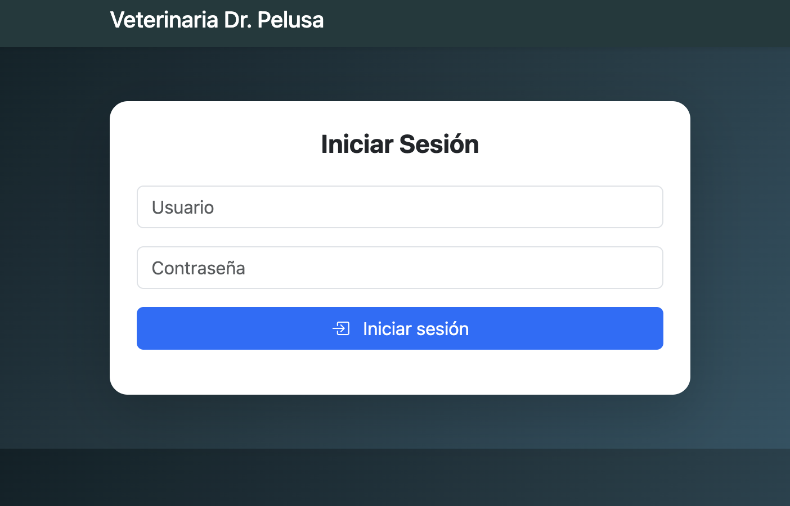
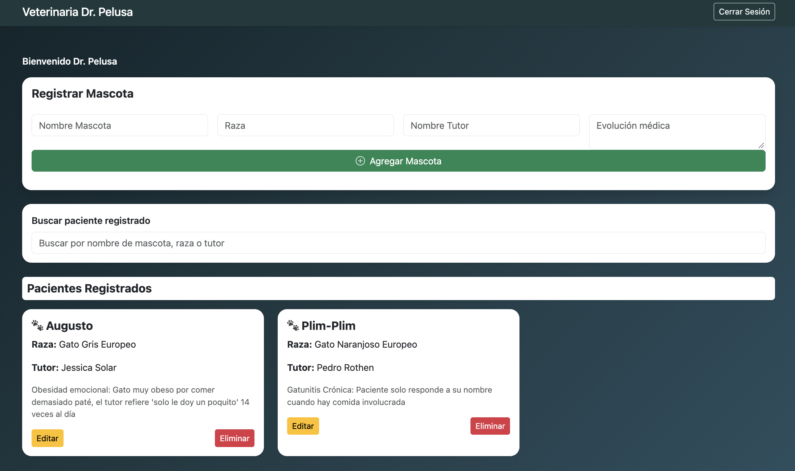

# Gestión Veterinaria V2

**Demo en vivo:** https://jessicasolaru.github.io/gestionVeterinaria/

Aplicación web frontend para la gestión de pacientes de una veterinaria. Proyecto final del Módulo 4 (JavaScript) del curso de Desarrollo de Aplicaciones FullStack JavaScript, enfocado en Programación Orientada a Objetos (POO), autenticación básica y manipulación del DOM con ES6+.

## Funcionalidades

- Iniciar sesión como veterinario (sin backend).
- Registrar mascotas con nombre, raza, tutor y evolución médica.
- Ver en pantalla la lista de pacientes del veterinario autenticado.
- Editar y eliminar mascotas registradas.
- Buscar pacientes por nombre, raza o tutor.
- Cerrar sesión y volver al login.

## Capturas





## Tecnologías

- HTML5
- CSS3
- JavaScript (ES6+)
- Bootstrap 5

## Credenciales de prueba

| Usuario | Contraseña |
| ------- | ---------- |
| `admin` | `1234`     |
| `sofia` | `abcd`     |

Son datos de prueba. La autenticación es simulada y no usa backend.

## Ejecución local

1. Clonar el repositorio:

```bash
git clone https://github.com/Jessicasolaru/gestionVeterinaria
cd gestionVeterinaria
```

2. Abrir el archivo `index.html` en el navegador, o usar la extensión **Live Server** de VS Code.

No requiere instalar dependencias.

## Estado del proyecto

Versión académica (V2) para practicar fundamentos de JavaScript orientado a objetos y manipulación del DOM.

## Autora

Desarrollado por **Jessica Solar**.
